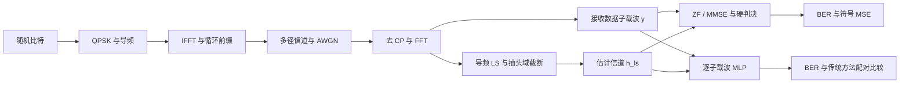
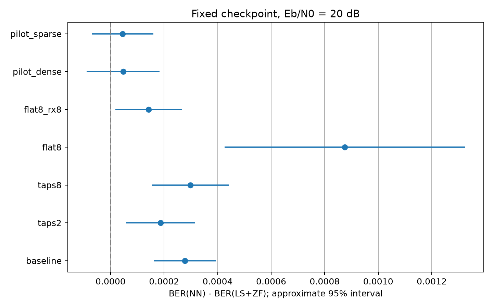

# QPSK-OFDM 神经接收机

使用 Python、NumPy 和 PyTorch，从 QPSK/AWGN 链路逐步实现 OFDM 多径仿真、传统接收机、MLP 神经检测器及多场景评估。这个项目用于系统学习 AI 与通信物理层，并通过可核对的实验分析模型的能力和局限。

**当前进度：week4 场景评估已运行完成。** 固定的 MLP 在本次测试中没有表现出优于传统方法的 BER；实验定位了信道估计截断造成的误码平台，并保留原始计数、配置和曲线。自动生成 `report.md` 的函数尚未实现。

## 四周完成的功能

| 阶段 | 已实现内容 | 入口 |
|---|---|---|
| week1 | QPSK 调制/硬判决、AWGN、理论与仿真 BER、星座图 | `week1_qpsk_awgn.py` |
| week2 | OFDM 调制/解调、CP、多径、导频 LS 与抽头域截断、ZF/MMSE、BER/MSE | `week2_ofdm.py` |
| week3 | 在线路仿真数据上训练逐子载波 MLP；训练/验证、检查点、独立测试 | `week3.train`、`week3.evaluate` |
| week4 | 固定检查点，评估 7 种场景、多随机种子、块级配对差值及近似置信区间 | `week4.run` |

## 链路和网络



基准配置为 SISO、64 点 FFT、16 点 CP、5 个独立复高斯信道抽头；功率时延谱指数衰减，总平均功率归一化。每 4 个子载波放一个 `1+0j` 导频，因此一个块有 16 个导频、48 个 QPSK 数据符号、96 个数据比特。每块独立生成信道，块内信道保持不变。

这里的一个 `frame` 是一个带 CP 的 OFDM 符号块，不是 LTE/NR 标准无线帧。噪声口径为单位 QPSK 符号能量下的**数据比特 Eb/N0**，未计入导频和 CP 开销；改变导频密度时还需要单独考虑吞吐量。

网络为 **`4 → 128 → 128 → 4` 的 MLP**，隐藏层使用 ReLU。每次输入单个子载波的 `[Re(y), Im(y), Re(h_ls), Im(h_ls)]`，输出 4 个 QPSK 类别的 logits，训练损失为交叉熵。当前网络没有联合读取相邻子载波、完整导频网格或连续时间块。

## 环境安装

建议 Python 3.11 或更新版本。已运行实验的环境为 Windows、Python 3.13.7、NumPy 2.3.5、Matplotlib 3.11.2、PyTorch 2.15.0+cpu。CPU 可以完成本项目；训练和评估会在 CUDA 可用时自动选择 CUDA。

在 **Windows CMD** 中执行：

```bat
git clone https://github.com/BillyHuang98/neural-receiver.git
cd neural-receiver
python -m venv .venv
.venv\Scripts\activate.bat
python -m pip install --upgrade pip
python -m pip install -r requirements.txt
python -c "import sys, numpy, matplotlib, torch; print(sys.executable); print(numpy.__version__, matplotlib.__version__, torch.__version__)"
```

这是私有仓库，克隆时使用有访问权限的 GitHub 账号。`requirements.txt` 声明兼容版本范围；原始实验的具体版本保存在各次 week4 的 `config.json` 中。

在 VS Code 中选择同一个 `.venv\Scripts\python.exe` 解释器，可使编辑器的导入解析与终端运行环境保持一致。

## 运行方法

以下命令均在项目根目录执行，使用已经激活环境中的 `python`。

### week1 和 week2：通信链路

```bat
python week1_qpsk_awgn.py
python week2_ofdm.py
```

程序会打印 BER，保存图片并显示绘图窗口；关闭窗口后程序继续或结束。week1 图片保存到当前工作目录；week2 图片保存到脚本所在目录的 `week_2_results_seed2026.png`。`results/` 保留了学习阶段归档的图片，不是上述脚本统一指定的自动输出目录。week1 的中文图形字体设置为 SimHei，在其他系统上可按已安装字体调整。

### week3：训练与评估

```bat
python -m week3.train --mode smoke
python -m week3.train --mode overfit
python -m week3.train --mode normal
```

- `smoke`：64 个训练块、16 个验证块、2 轮，用于检查流程。
- `overfit`：4 个块、固定 30 dB、300 轮，训练验证共用数据，用于检查能否拟合小样本。
- `normal`：4000 个训练块、600 个验证块、20 轮，Eb/N0 在 0～20 dB 均匀采样，训练与验证分别生成。

可以用 `--epochs 50` 覆盖训练轮数。其他训练参数位于 [week3/config.py](week3/config.py)。每次训练新建 `runs/<模式>_<时间戳>/`，保存 `config.json`、`history.csv` 和 `best.pt`。最佳模型按**最低验证交叉熵**选择，可能早于最后一轮。

仓库保留了原始正常训练检查点，可直接测试：

```bat
set "checkpointPath=runs\normal_20261108_164820_989768\best.pt"
python -m week3.evaluate --checkpoint "%checkpointPath%" --frames 1000
```

重新训练后，将 `checkpointPath` 替换为新目录中的 `best.pt`。week3 评估输出 `test_ber.csv` 和 `test_ber_1.png` 到检查点所在目录，重复执行会覆盖这两个文件。当前评估点为 0、4、8、12、16、20 dB。

### week4：固定模型的多场景评估

```bat
set "checkpointPath=runs\normal_20261108_164820_989768\best.pt"
python -m week4.run --checkpoint "%checkpointPath%" --mode smoke
python -m week4.run --checkpoint "%checkpointPath%" --mode full --frames 1000 --repeats 3 --seed 20261109
```

`smoke` 固定每次 20 块、1 个测试种子、0/12/20 dB，只检查流程。`full` 使用 `--frames` 和 `--repeats`，默认每点合计 3000 块，评估 0～20 dB、间隔 4 dB。`--repeats` 增加测试采样次数，不重新训练模型。

程序只接受正常训练检查点，并核对原通信参数签名。改变测试条件通过 `Scenario` 完成，保持检查点对应的 week1/week2 基准参数不变。每次新建 `runs/week4_<模式>_<时间戳>/`，保存：

| 文件 | 内容 |
|---|---|
| `config.json` | 训练配置、场景、测试规模、随机种子、环境、检查点 SHA-256 |
| `raw.csv` | 各场景/SNR/重复次数的错误数、比特数、MSE 和配对差值统计量 |
| `summary.csv` | 合并后的 BER/MSE、NN−ZF 差值和近似 95% 区间 |
| `ber_<场景>.png` | 各场景的四种方法 BER |
| `comparison.png` | 最高测试 Eb/N0 下 NN−ZF 的横向误差棒图 |
| `mse_baseline.png` | 基准场景中 ZF 与 MMSE 的符号 MSE |

当前程序不生成 `report.md` 或运行目录中的 README；对话中讨论的 `write_report()` 尚未写入源码。

查看参数：`python -m week3.train --help`、`python -m week3.evaluate --help`、`python -m week4.run --help`。

**终端区别：** 上面的 `%checkpointPath%`、`set`、`activate.bat` 属于 CMD。PowerShell 可直接使用下面的形式；本机若显式指定带引号的解释器路径，应写 `& "D:\python\python.exe" ...`。

```powershell
$checkpointPath = "runs/normal_20261108_164820_989768/best.pt"
python -m week4.run --checkpoint $checkpointPath --mode full --frames 1000 --repeats 3
```

## 七种测试场景

| 场景 | 真实抽头数 | 估计保留抽头数 | 平均功率分布 | 导频间隔 | 导频数 / 数据数 |
|---|---:|---:|---|---:|---:|
| `baseline` | 5 | 5 | 指数衰减 | 4 | 16 / 48 |
| `taps2` | 2 | 5 | 指数衰减 | 4 | 16 / 48 |
| `taps8` | 8 | 5 | 指数衰减 | 4 | 16 / 48 |
| `flat8` | 8 | 5 | 均匀 | 4 | 16 / 48 |
| `flat8_rx8` | 8 | 8 | 均匀 | 4 | 16 / 48 |
| `pilot_dense` | 5 | 5 | 指数衰减 | 2 | 32 / 32 |
| `pilot_sparse` | 5 | 5 | 指数衰减 | 8 | 8 / 56 |

`flat8` 中的 flat 指各抽头**平均功率相同**，该多径信道仍具有频率选择性。`flat8_rx8` 是定位估计长度失配的对照场景。

## 已保存的实验结果

来源：[2026-11-16 完整评估](runs/week4_full_16112026_134308_207776/summary.csv)、[原始统计](runs/week4_full_16112026_134308_207776/raw.csv)、[实验配置](runs/week4_full_16112026_134308_207776/config.json)。使用原始 0～20 dB 正常训练的**第 18 轮**检查点；7 场景 × 6 个 Eb/N0 × 3 个种子，共 126 次测试、42 条汇总记录。

20 dB 的结果如下，**BER 统一以百分比显示**：

| 场景 | LS+ZF / LS+MMSE | NN | Perfect CSI+ZF |
|---|---:|---:|---:|
| baseline | 0.306944% | 0.334722% | 0.229514% |
| taps2 | 0.322917% | 0.341667% | 0.261111% |
| taps8 | 0.625694% | 0.655556% | 0.244444% |
| flat8 | 16.413889% | 16.501389% | 0.256250% |
| flat8_rx8 | 0.381597% | 0.395833% | 0.256250% |
| pilot_dense | 0.283854% | 0.288542% | 0.252083% |
| pilot_sparse | 0.401190% | 0.405655% | 0.249107% |

基准及其他导频间隔 4 的场景，每点 288000 比特；密导频每点 192000 比特，疏导频每点 336000 比特。



### 如何理解当前结果

1. **ZF 和 MMSE 的 BER 一致、MSE 可以不同。** 当前标量均衡公式的分子同为 `conj(h_ls) * y`，分母是正实数。QPSK 硬判决只看象限，因此判决相同；缩放会改变与原星座点的距离，另见 [MSE 曲线](runs/week4_full_16112026_134308_207776/mse_baseline.png)。
2. **当前网络的输入信息与传统方法相同。** 在本仿真的独立圆对称复高斯抽头、AWGN、等概恒模 QPSK 和线性导频估计条件下，给定单子载波 `(y, h_ls)` 的最优判决仍是 `conj(h_ls) * y` 的象限。有限样本训练的 MLP 在近似这一规则，尤其在衰落困难样本上存在剩余误差。扩大网络或增加训练轮数，不会自动带来额外观测信息。
3. **flat8 的主要瓶颈是估计截断。** 真实 8 条等平均功率路径只保留 5 条，遗漏平均总功率的 `3/8 = 37.5%`。两类接收机共享这份估计，所以都会退化。保留 8 条后，两类方法的 BER 都明显恢复，见 [flat8](runs/week4_full_16112026_134308_207776/ber_flat8.png) 与 [flat8_rx8](runs/week4_full_16112026_134308_207776/ber_flat8_rx8.png)。
4. **区间反映固定模型的测试采样波动。** 使用独立 OFDM 块的配对差值，计算均值 ± 1.96×标准误。本次 42 点的 NN−ZF 均为正，其中 34 点区间完全为正、8 点包含零；小差距应结合区间解释。该区间没有计入不同训练种子的波动，也没有做多重比较校正。

这些结论的适用范围是当前仿真模型、输入和测试分布。后续拟研究利用完整导频/相邻子载波的学习型信道估计，并与使用同样信息的传统方法公平比较；目前尚未实现。

## 目录与学习记录

```text
neural-receiver/
├── README.md
├── requirements.txt
├── week1_qpsk_awgn.py
├── week2_ofdm.py
├── week3/                 # 配置、数据集、MLP、训练、评估
├── week4/                 # 多场景仿真和评估统计
├── runs/                  # 小型检查点、配置、CSV 和结果曲线
├── results/               # 早期绘图归档
├── legacy/                # 按阶段整理的开发日志
└── chats/                 # 日志所依据的原始对话记录
```

开发日志按当时进度保留，旧文中的“未修正”“尚未运行”反映写作时状态；后续进展在新日志中续记。

- [01：QPSK 与 AWGN](legacy/01_week1_QPSK_AWGN.md)
- [02：OFDM](legacy/02_week2_OFDM.md)
- [03：配置与数据集](legacy/03_2026-11-06_配置与数据集.md)
- [04：网络与训练](legacy/04_2026-11-07_网络与训练.md)
- [05：调试与评估](legacy/05_2026-11-08_调试与评估.md)
- [06：week4 第一部分，场景与统计设计](legacy/06_week4_p1_场景评估与统计分析.md)
- [07：week4 第二部分，运行、绘图与结果分析](legacy/07_week4_p2_运行绘图与结果分析.md)
- [补充实验：20 轮与 50 轮训练对照](runs/epoch50_comparison_20261109/README.md)

## 下一步

- [ ] 补充自动实验报告 `write_report()`，使报告内容直接来自保存的配置和统计。
- [ ] 将无噪声和按信道幅度分组的诊断整理成独立可运行入口，保存原始计数。
- [ ] 在现有基线上设计学习型信道估计或邻域联合检测，比较相同输入信息和导频开销下的结果。
- [ ] 增加训练种子对照，研究验证交叉熵、BER 与深衰落表现之间的关系。
