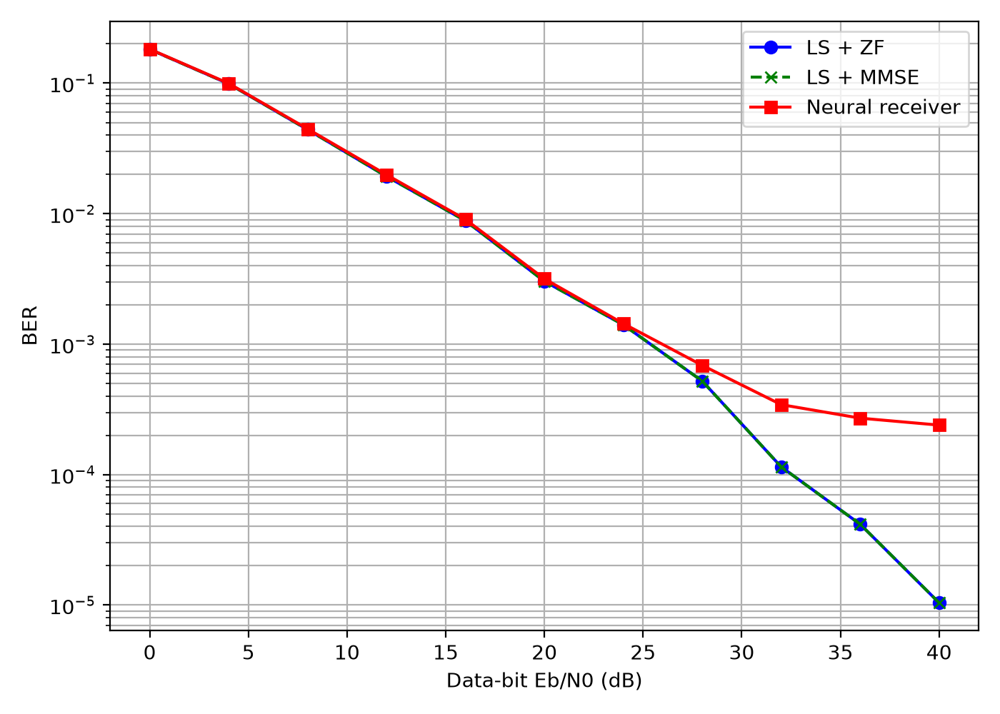

# 开发日志 05：第三周调试、训练与 BER 评估

日期：2026-11-08。

来源：[2026-11-08 对话记录](../chats/神经接收机20261108.pdf)及本聊天中的环境检查、代码排错、运行反馈和曲线分析。实测依据为现有 [runs 目录](../runs/) 中的配置、训练记录和测试结果。本篇将原 PDF 的学习内容与当天后来发生的实际运行分开记录。

## 1. 阶段目标

我完成第三周程序的编写和检查，运行快速检查、小样本过拟合、正常训练和独立测试，确认从通信仿真到模型训练、保存、加载、输出结果的流程可以运行。同时记录仍需继续理解的 BER 曲线问题。

## 2. 实际进度

- 已完成 `config.py`、`data.py`、`model.py`、`train.py`、`evaluate.py` 和包入口文件的编写。
- 核实了 torch 的安装位置，区分项目虚拟环境与实际用于运行的 Python。
- 按本聊天的排查修改八处代码问题，解决 CMD 中误用 PowerShell 调用符号的问题。
- 已运行 smoke 2 轮、overfit 300 轮和 normal 20 轮，并使用正常训练保存的模型完成六个信噪比的测试。
- 已生成每次训练的 `config.json`、`history.csv`、`best.pt`，正常训练目录还包含 `test_ber.csv`、`test_ber.png`。
- **尚未关闭：为什么三条 BER 曲线几乎重合，以及当前神经检测器的性能空间该怎样理解。**

## 3. 学习知识点

### 命令行、随机数与数据加载

- `argparse.ArgumentParser()` 定义参数规则；`parse_args()` 将命令行解析为 `Namespace` 对象，可用 `args.mode`、`args.checkpoint` 读取。`required=True` 要求提供参数。
- 当前文件使用相对导入，优先在根目录按模块运行：`python -m week3.train`、`python -m week3.evaluate`。直接点击“运行当前文件”并不自动补齐包上下文和评估参数；若以后配置调试，也应使用模块入口。
- `seed + 1`、`seed + 2` 用于分别生成训练和验证样本；测试用 `seed + 1000 + index`。不同种子避免复用相同生成序列，不等于数学上保证任意样本绝不重复。
- NumPy 的 `rng` 控制比特、信道、噪声等仿真随机量；DataLoader 的 `torch.Generator` 控制这里的随机采样顺序。两者分工不同。
- SNR 随机采样不等于样本顺序已经充分打乱：同一个块的 48 个子载波仍相邻且共享信道。`shuffle=True` 每轮重新排列训练样本顺序，不改变样本内容。
- `num_workers=0` 表示在主进程加载数据，不是“零个线程”；`torch.set_num_threads(...)` 控制 CPU 张量算子的线程数，是另一层并行设置。
- overfit 模式特意令训练、验证为同一数据集，只检查能否学会少量样本。normal 模式使用分别生成的数据，才能评估泛化。

### 对象、设备与指标

`.to(device)` 可用于张量和 `nn.Module`，让特征、标签和模型处于兼容的设备；它不是任意 Python 对象都具备的方法。点号通常表示访问对象属性或方法，不表示“这个变量变成了函数”。

NumPy 数组的 `array.size` 是元素总数属性；PyTorch 张量的 `tensor.size(0)` 是第 0 维长度，本例即当前批次样本数。`.sum().item()` 先累计布尔错误，再提取为 Python 数值。这里的布尔误码统计本身没有可微计算图，不应笼统地说不加 `item()` 就必然导致计算图或显存泄漏。

最后一个批次可能不满 512，因此按实际批大小汇总损失：

~~~python
sample_count += labels.size(0)
loss_sum += loss.item() * labels.size(0)
~~~

整个数据集平均损失为 `loss_sum / sample_count`，BER 为 `bit_errors / (2 * sample_count)`。分类错误率与比特错误率要分别计算。

### 实验记录、保存与评估

- `Path` 的 `/` 用于拼接路径；`mkdir(parents=True, exist_ok=False)` 创建本次实验目录。`datetime` 时间戳用于区分运行。
- `with ... as f` 中，`f` 是打开的文件对象；`csv.DictWriter` 负责将字典按字段组织成 CSV 文本。`writerow` 写一个字典，`writerows` 写多个字典。
- `asdict(cfg)` 把配置数据类转成字典；`json.dump(...)` 将其写成配置文件。f-string 前缀 `f` 与文件变量 `f` 没有绑定关系。
- `print(..., flush=True)` 刷新终端输出，`f.flush()` 刷新文件流缓冲；后者不等同于保证硬件已持久化的磁盘同步。
- `model.state_dict()` 返回参数及已注册持久缓冲的映射；`optimizer.state_dict()` 保存优化器状态。`torch.save` 把它们连同配置、轮次、通信签名等一起保存。
- `best.pt` 按最低验证损失选择，不一定来自最后一轮，也不一定来自最低验证 BER 的一轮。
- `torch.load(..., weights_only=True)` 限制可反序列化的类型，不是只读取 `model_state` 字段；受支持的配置字典等仍可读取。`map_location="cpu"` 先将张量加载到 CPU。
- `Trainconfig(**checkpoint["config"])` 用保存的配置恢复对象，`**` 在这里表示关键字参数解包，避免误用当前默认隐藏宽度。
- `enumerate(ebn0_values_db)` 是单层遍历，每次同时得到序号和一个信噪比。固定 SNR 的测试集与训练时混合 SNR 的数据集服务于不同目的。
- `np.where(values > 0, values, np.nan)` 让零 BER 点不进入对数曲线；有限样本未观察到错误不代表真实错误概率一定为零。`fig` 是画布，`ax` 是其中的坐标区域，`tight_layout()` 调整布局。

对原对话补充两点：固定种子有助于复现，但不保证跨硬件、版本和算法设置逐位一致；当前检查点虽保存优化器状态，程序尚无续训入口，也没有保存完整随机状态，不能称作“已经实现精确断点续训”。AdamW 使用解耦权重衰减，也不宜直接与所有优化器中的 L2 正则处理画等号。

## 4. 错误与修正

### 环境与终端

PDF 中出现过安装 torch 的 `ProxyError`，当时讨论了代理检查、安装源和离线安装等方法；记录未证明每种方法都实际执行。随后本聊天直接核实：

| 环境 | 核实情况 |
|---|---|
| `D:\python\python.exe`，Python 3.13 | 已有 `torch 2.15.0+cpu`，可导入并计算张量；本次训练实际使用它。 |
| 项目 `.venv_week3\Scripts\python.exe`，Python 3.11 | 检查时有 NumPy、Matplotlib，没有 torch。 |

因此“pip 已安装”和“编辑器无法解析导入”可以同时发生：它们指向了不同解释器。修复思路是统一编辑器与运行解释器，或用目标解释器的 `-m pip` 安装。本次成功运行采用显式指定全局解释器；**没有据此认定虚拟环境也已安装成功**。

另一次报错为“此时不应有 &”。截图中的终端是 CMD，而复制的命令使用 PowerShell 的调用形式。CMD 删除开头的 `&`，保留路径双引号。此操作问题已解决；程序目前仍打印 PowerShell 形式的评估命令，在 CMD 中复制时仍需删除该符号。

### 八处实际代码问题

| 位置 | 错误写法或现象 | 原因与修正 | 状态 |
|---|---|---|---|
| `data.py` | `equalize_mmse(received_freq, h_ls)` | 少传噪声方差；补上第三个参数 `noise_var`。 | 已修正并跑通。 |
| `train.py` | `smaple_count += ...` | 变量名拼错；统一为 `sample_count`。 | 已修正并跑通。 |
| `train.py` | `device = choose_device` | 得到函数对象而非设备；改为 `choose_device()`。 | 已修正并跑通。 |
| `train.py` | 拼出 `week3.evaluate--checkpoint` | 相邻字符串不会自动补空格；在模块名之后添加空格。 | 已修正；CMD 的 `&` 差异另行处理。 |
| `evaluate.py` | `checkpoint["stimulation"]` | 与保存时的键不符；改为 `checkpoint["simulation"]`。 | 已修正并完成加载。 |
| `evaluate.py` | `writer.writerow(rows)` | `rows` 是多个字典构成的列表；改为 `writer.writerows(rows)`。 | 已修正并生成 CSV。 |
| `evaluate.py` | 保存和画图在 SNR 循环内部 | 首次循环只有一个结果，完整横坐标已有六点；将输出部分移到循环后。 | 已修正并生成六点结果图。 |
| `evaluate.py` | 程序入口缩进在 `main()` 内 | 直接执行时只定义函数，未调用；将入口放到文件最外层。 | 已修正，评估可正常启动。 |

另外将显示文字 `Ed/N0` 改成了 `Eb/N0`。它影响标签，不影响计算。

### 本次运行命令

以下是适用于截图中 **CMD** 的复现命令，运行前先切换到项目根目录：

~~~bat
cd /d "C:\Users\huangmian\Desktop\桌面上的一些文件夹\神经接收机"
"D:\python\python.exe" -m week3.train --mode smoke
"D:\python\python.exe" -m week3.train --mode overfit
"D:\python\python.exe" -m week3.train --mode normal
"D:\python\python.exe" -m week3.evaluate --checkpoint "runs\normal_20261108_164820_989768\best.pt" --frames 1000
~~~

最后一条指向本次已存在的检查点。重新训练会生成新的目录，评估新模型时要相应修改路径。PowerShell 中执行带引号的解释器路径，则采用：

~~~powershell
& "D:\python\python.exe" -m week3.train --mode normal
~~~

## 5. 实验或问题分析

### 已确认的运行记录

下表来自现有文件，数字按六位小数显示，完整精度保留在对应 CSV 中。

| 模式与记录 | 数据规模及轮数 | 结果 |
|---|---|---|
| [smoke 训练记录](../runs/smoke_20261108_164408_171934/history.csv) | 训练 64 块、验证 16 块，2 轮 | 末轮训练 loss 1.283626，验证 loss 1.261084，验证 BER 0.186198。 |
| [overfit 训练记录](../runs/overfit_20261108_164516_161603/history.csv) | 4 块、训练验证共用，30 dB，300 轮 | 末轮训练 BER 0，验证 BER 0，验证 loss 0.015858。 |
| [normal 训练记录](../runs/normal_20261108_164820_989768/history.csv) | 训练 4000 块、验证 600 块，20 轮 | 验证 loss 最低为第 18 轮，保存为 `best.pt`。 |

normal 的训练集有 192000 条样本，验证集有 28800 条样本；batch 为 512、学习率 0.001、隐藏层宽度 128，训练 Eb/N0 为 0～20 dB，种子 2026。详细指标为：

| 轮次 | 训练 loss | 训练 BER | 验证 loss | 验证 BER |
|---|---:|---:|---:|---:|
| 1 | 0.416950 | 0.065617 | 0.258291 | 0.047431 |
| 18，最低验证 loss | 0.261877 | 0.051604 | 0.243528 | 0.047153 |
| 20，最后一轮 | 0.261918 | 0.051617 | 0.244041 | 0.047604 |

评估使用的是第 18 轮的模型，每个信噪比 1000 个块，即 48000 个数据符号、96000 个比特：

| Eb/N0（dB） | LS + ZF BER | LS + MMSE BER | 神经网络 BER |
|---|---:|---:|---:|
| 0 | 0.181760 | 0.181760 | 0.182438 |
| 4 | 0.098990 | 0.098990 | 0.099625 |
| 8 | 0.044094 | 0.044094 | 0.044625 |
| 12 | 0.019302 | 0.019302 | 0.019865 |
| 16 | 0.008823 | 0.008823 | 0.009031 |
| 20 | 0.003031 | 0.003031 | 0.003167 |

完整数值见 [test_ber.csv](../runs/normal_20261108_164820_989768/test_ber.csv)，对应图如下：

### 问题 NR-001：为什么三条 BER 曲线几乎重合？

> **状态：未解决。**
>
> **问题：为什么 LS+ZF、LS+MMSE 与神经接收机的 BER 曲线几乎重合？**
>
> **续接日期：2026-11-09。** 已有初步分析和实际数据，保留过程，暂不关闭问题。

当前观察：两个传统算法的 BER 完全相同；网络在这次六个测试点上略高。本聊天中加载保存的模型，按原测试种子复算了六个点，与 CSV 一致。

20 dB 时传统接收机错 291 个比特，网络错 304 个。进一步对比有 93 个比特的判决不同：网络修正传统方法的 40 个错误，同时新增 53 个错误。这解释了两条线为何接近，但不表示对所有随机种子都已证明同样差距。

已有的分析线索：

1. 当前 SISO QPSK 硬判决只看实部和虚部正负。ZF 与 MMSE 先计算相同的 `conj(h_ls) * y`，再除以不同的正实数，因此硬判决相同；判决前的 MSE 仍可能不同。
2. 网络输入仍为单个子载波的 `y` 与同一份 LS 估计。信道线性、CP 足够长，估计还使用已知的 5 径长度，传统基线已利用了较多模型信息。
3. 当前 MLP 逐子载波分类，尚未联合利用相邻频率或时间位置。结果与学到接近传统检测规则的情况一致，不能据此断言神经接收机普遍没有优势。
4. 训练 loss 下降、overfit 的 BER 为 0，说明已有学习和训练流程有效的证据；“能学习”与“超过基线”是两个需要分别验证的目标。

后续讨论过减少导频、联合相邻子载波、使用 CNN 等方向，**均未实现或验证**。若做这类实验，也应加入利用相关性的传统估计方法，并核算导频开销，不能把扩大模型本身当作性能改进证明。

## 6. 后续待办

- [ ] **2026-11-09 继续 NR-001**：用具体复数例子和代码核对 ZF/MMSE 的幅度、象限、硬判决与 MSE 的关系。
- [ ] 梳理网络目前接收的信息、能改变的处理步骤和传统基线已经使用的信息，形成我能自行说明的解释；本篇先保持“未解决”。
- [ ] 决定是否进一步做多随机种子验证，或规划减少导频并联合相邻子载波的实验；未决定前不改现有基线。
- [ ] 如需要继续使用 `.venv_week3`，先核实该环境的 torch 安装和解释器选择；目前已成功运行的是显式指定的 `D:\python\python.exe`。

