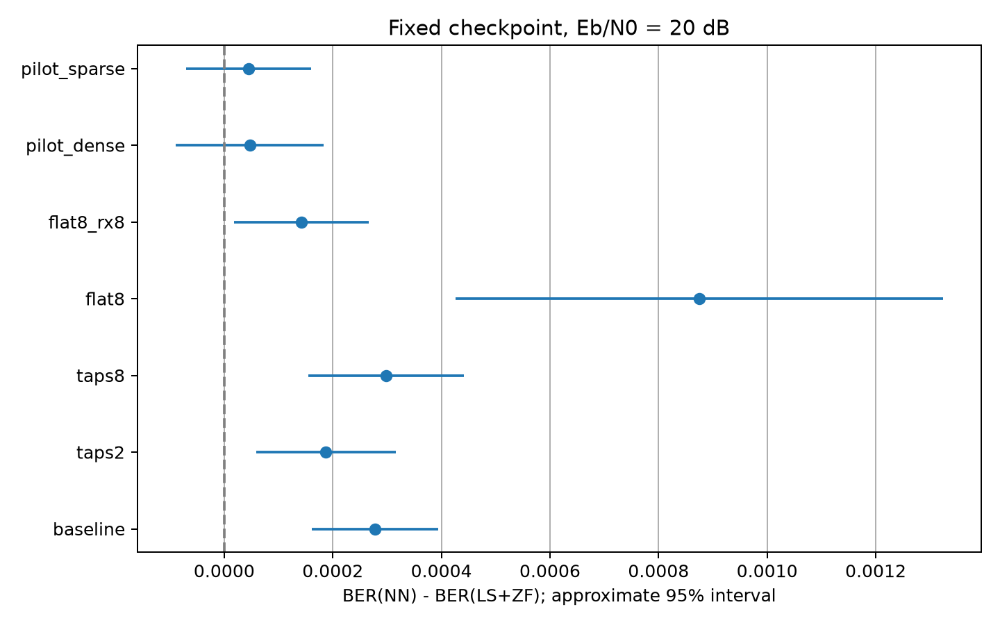
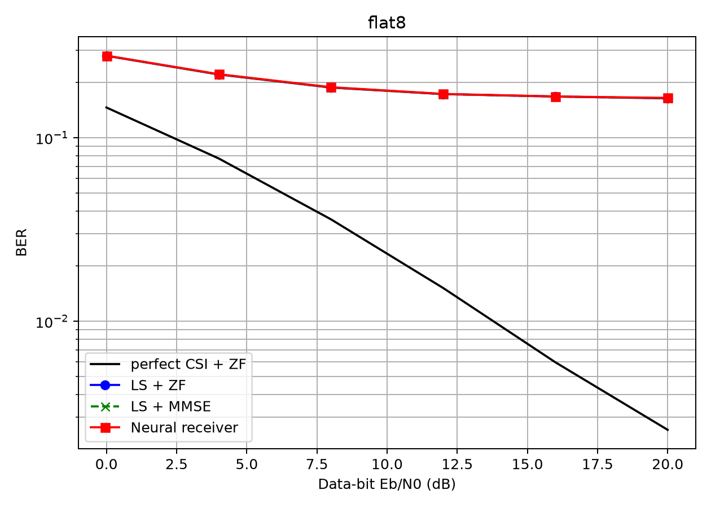

# 开发日志 07：第四周（二）——运行、绘图与结果分析

整理日期：2026-11-16。阶段：week4 第二部分。

日期说明：原始对话没有逐条时间戳，本篇按整理日归纳学习内容；当天完整评估的时间由实验目录和配置核实。上一篇保留 11 月 14 日的状态，本篇续记后续修改和运行结果。

来源与核对依据：

- [week4_p2 原始 Word 对话](../chats/神经接收机week4_p2.docx)。用户提供的 [Gemini 分享链接](https://share.gemini.google/MohdyPumQGJw)对应这一阶段；在线正文接口读取失败后，改用更新后的本地完整记录。Word 中主要是代码、绘图和主流程的问答，没有嵌入截图。
- 当前源码：[评估主流程](../week4/run.py)、[场景仿真器](../week4/simulator.py)、[数据与通信参数签名](../week3/data.py)、[训练](../week3/train.py)、[网络](../week3/model.py)。
- 当天正式实验：[完整配置](../runs/week4_full_16112026_134308_207776/config.json)、[126 次原始记录](../runs/week4_full_16112026_134308_207776/raw.csv)、[42 条汇总记录](../runs/week4_full_16112026_134308_207776/summary.csv)。
- **本聊天补充回顾**：代码检查后的运行方式、CMD 语法、NN 为什么仍落后、flat8 的截断问题，以及当时仅在内存中运行的无噪声和逐比特诊断。它们与 Word 中的基础语法学习分开说明。

## 1. 阶段目标

我希望把上一阶段写到一半的评估工具跑通：完成参数解析、检查点加载、三层测试循环、结果保存和绘图，然后能够结合配置解释曲线，而不只看哪条线更低。

这一周固定第三周的 MLP 权重，检验信道长度、功率分布和导频密度变化的影响。`repeats` 指测试重复次数，不是网络重新训练的次数。

## 2. 实际进度

| 内容 | 本阶段状态 |
|---|---|
| 仿真器逐块生成数据 | 已将数据、信道、噪声、特征、标签和指标统计放入块循环，正式评估已完成。 |
| 场景校验与字段名称 | 当前已调用 `scenario.validate()`，并统一 `mmse_mse`、`difference_square_sum`。 |
| 主程序 | 已完成参数解析、模型/签名核对、设备设置、随机种子派生和 7 场景评估。 |
| 输出与绘图 | 已保存配置、原始 CSV、汇总 CSV、7 张 BER 图、差值误差棒图和 baseline MSE 图。 |
| 快速检查 | 已有 [week4 smoke 结果](../runs/week4_smoke_16112026_134246_081784/summary.csv)。 |
| 正式实验 | 每场景 6 个 Eb/N0、每点 3 次、每次 1000 块；共 126 次运行、42 条汇总。 |
| 自动报告 | 原对话给出了 `write_report()` 示例，我尚未把它写入源码；当前程序没有自动输出 `report.md`。 |
| 仓库说明 | 本次整理新增根目录 README、依赖文件和忽略规则，准备将代码及学习/实验记录归档到私有 GitHub 仓库。此项不代表自动报告函数已经实现。 |

正式评估使用 `runs/normal_20261108_164820_989768/best.pt`，来自 **20 轮、0～20 dB 训练中的第 18 轮**，SHA-256 与配置记录一致。这次没有加载 0～40 dB 模型，也没有加载 50 轮实验模型。以后解释结果时先检查具体权重，不能只看文件名都叫 `best.pt`。

## 3. 学习知识点

### 3.1 三种图各自回答什么问题

**BER 曲线**：每个场景一张，横轴是数据比特 Eb/N0（dB），纵轴是 BER 的对数坐标；比较 Perfect CSI+ZF、LS+ZF、LS+MMSE 和 NN。`semilogy` 只把纵轴设为对数轴，横轴仍按输入的 dB 数值线性排布。

```python
rows = [r for r in summary if r["scenario"] == scenario.name]
snrs = [r["ebn0_db"] for r in rows]
values = np.array([r[key + "_ber"] for r in rows])
ax.semilogy(snrs, np.where(values > 0, values, np.nan), style)
```

`np.where` 把零 BER 替换成 NaN，让该点不进入对数绘图；它可能在曲线上留下空缺。有限样本没有观察到错误，不等于总体误码概率为零。

**配对差值图**：固定最高测试信噪比，纵轴每行一个场景，横轴为 `BER(NN) - BER(LS+ZF)`。圆点是估计差值，水平误差棒是近似 95% 区间，竖直零线表示两方法 BER 相等。

```python
positions = np.arange(len(rows))
delta = np.array([r["delta_ber"] for r in rows])
width = np.array([(r["ci_high"] - r["ci_low"]) / 2 for r in rows])
ax.errorbar(delta, positions, xerr=width, fmt="o")
ax.set_yticks(positions, [r["scenario"] for r in rows])
ax.axvline(0, color="gray", linestyle="--")
```

区间全在零右侧，支持当前 NN 的期望 BER 更高；全在左侧，支持更低；包含零时，当前样本对差异的证据不足。`fmt="o"` 指定只画圆形中心标记，不连不同场景。

**MSE 曲线**：比较硬判决前的均衡符号误差。ZF 与 MMSE 的 BER 相同，并不妨碍它们的符号 MSE 不同；这张图用于观察幅度缩放的影响。

### 3.2 数组、刻度与格式化

| 写法 | 我现在的理解 |
|---|---|
| `np.array(sequence)` | 把已有数据转为 ndarray，适合逐元素数值运算。 |
| `np.arange(n)` | 生成 `0` 到 `n-1` 的数值位置，本例用于场景的纵坐标。 |
| `list(range(0, 21, 4))` | 展开得到 `[0, 4, 8, 12, 16, 20]`。 |
| `[range(0, 21, 4)]` | 只有一个 range 对象的列表，不会自动展开。 |
| `len(a)` / `a.size` | 对二维 NumPy 数组，前者是第一维长度，后者是总元素数；例如 `(3,4)` 对应 3 和 12。 |
| `tensor.size()` | PyTorch 的形状查询方法；总元素数用 `tensor.numel()`。 |
| `set_yticks(positions, labels)` | 数值位置与文字标签一一对应，长度要相同。 |
| `grid(True, axis="x")` | 开启 x 刻度对应的竖向网格。 |
| `grid(True, which="both")` | 包括主、次刻度网格；`which` 选择刻度层级，`axis` 选择坐标方向。 |
| `:12s`、`:2d`、`:.6f` | 字符串最小宽度 12、整数最小宽度 2、浮点数保留 6 位小数。 |

list 用于动态收集场景和结果字典，ndarray 用于信号、FFT 和向量计算。ndarray 具有统一 dtype；`object` 等 dtype 仍能容纳不同 Python 对象，所以不把“统一 dtype”扩大解释为任何数组元素都必须是同一种 Python 对象。

### 3.3 命令行参数与三步恢复网络

`add_argument()` 定义参数规则，`parse_args()` 才读取、转换和检查实际命令行输入。`type=Path` 会将权重路径变成 Path 对象，`required=True` 要求提供该参数。

恢复网络分三步：

```python
checkpoint = torch.load(checkpoint_path, map_location="cpu", weights_only=True)
model = NeuralReceiver(checkpoint["config"]["hidden_dim"]).to(device)
model.load_state_dict(checkpoint["model_state"])
model.eval()
```

先读文件中的字典，再建立网络结构，随后把保存的参数装进去。`checkpoint["config"]["mode"]` 是连续读取嵌套字典；`simulation` 字段由 `week3/data.py` 的 `simulation_signature()` 构造，在训练保存检查点时写入。

`model.eval()` 切换评估行为，主要影响 Dropout、BatchNorm 等层；本网络只有 Linear/ReLU。禁用梯度记录依靠外层的 `torch.inference_mode()`，本评估流程也没有反向传播和优化器更新。原对话把 eval 简述为“不再更新参数”，本篇补全其实际机制。

`weights_only=True` 使用受限反序列化，不是只取 `model_state`，也不代表对任意文件的安全性作绝对保证。`map_location="cpu"` 先在 CPU 加载张量，模型随后再放到选定设备。

### 3.4 实验目录、元数据和随机数

Path 的 `/` 是路径拼接；`mkdir(parents=True, exist_ok=False)` 创建新运行目录并拒绝覆盖同名目录。`(output / "config.json").write_text(...)` 在其中写文件，`json.dumps(..., ensure_ascii=False, indent=2)` 生成便于阅读的 JSON 文本。

metadata 同时记录权重来源、训练参数、场景、测试种子、数据规模和环境版本。`hashlib.sha256(path.read_bytes()).hexdigest()` 得到 **64 个十六进制字符、256 比特**的文件摘要，便于识别误用或改动的权重；它是极可靠的工程核验，不把哈希描述为数学上绝无碰撞的“百分百唯一标识”。

```python
seed = int(np.random.SeedSequence([args.seed, index, repeat]).generate_state(1)[0])
```

`SeedSequence` 混合基准种子、SNR 序号和重复编号，避免简单相加造成显然的重号。`generate_state(1)` 返回长度为 1 的整数数组，`[0]` 取值，再转 Python int。同一输入可派生相同状态，但压缩成单个 32 位整数仍存在碰撞可能；跨版本、设备的整个训练结果也不是仅靠种子就能保证逐位相同。

不同场景复用相同派生种子。若信道抽头数、数据子载波数改变，随机数消耗顺序也改变，不能据此称所有场景的比特/信道/噪声都完全相同。`flat8` 与 `flat8_rx8` 只改变估计保留长度，随机生成部分相同，是有针对性的对照。同一场景的一次 trial 内，各算法始终共享同一批数据。

### 3.5 我以后怎样自己写 CMD 命令

```bat
set "checkpointPath=runs\normal_20261108_164820_989768\best.pt"
"D:\python\python.exe" -m week4.run --checkpoint "%checkpointPath%" --mode smoke
"D:\python\python.exe" -m week4.run --checkpoint "%checkpointPath%" --mode full --frames 1000 --repeats 3
```

运行前在 CMD 用 `cd /d "项目根目录"` 切换目录。通用形式为 `"解释器路径" -m 包名.模块名 --参数名 值`。本程序的相对导入需要按模块运行；VS Code 也可以通过调试配置传入模块和参数，不能笼统说运行按钮永远无法传参。

CMD 通过 `set "变量=值"` 定义变量，通过 `%变量%` 取值；带空格的路径放在英文双引号内。PowerShell 调用带引号的解释器路径使用前缀 `&`。两种终端的变量语法分开使用。

## 4. 错误与修正

| 错误写法或现象 | 原因 | 正确方式 | 解决状态 |
|---|---|---|---|
| 上篇的块循环只包住一次随机数调用 | 其余块的数据未填写，语法通过仍无法保证实验正确 | 每块的数据生成和统计放回循环，返回语句留在循环外 | 当前源码已修正，smoke/full 已运行。 |
| `scenario.validate` | 只取方法对象 | `scenario.validate()` | 已修正。 |
| `zf_mmse` 与 `mmse_mse` 混用，或 `difference_squre_sum` 少字母 | 上下游字典字段不一致 | 统一 `mmse_mse`、`difference_square_sum` | 已修正。 |
| `snrs = [range(0,21,4)]` | 将 range 对象整体装进列表 | `snrs = list(range(0,21,4))` | 当前源码为正确写法；原对话是写法比较，不认定错误版本已运行。 |
| 把 `which="both"` 理解成 x/y 两轴 | 刻度层级与坐标方向混淆 | `which` 管主/次刻度，`axis` 管 x/y | 概念已澄清。 |
| 将 NumPy 的 `a.size` 写成 `a.size()`，或把它当行数 | 属性、方法与统计口径混淆 | NumPy 总数用 `.size`，第一维用 `len(a)` | 概念已澄清。 |
| CMD 复制 PowerShell 的 `& "python.exe" ...` | 终端语法不匹配 | CMD 直接调用带引号的解释器；PowerShell 才使用该前缀 | 本聊天已明确运行方式。 |
| `axis=1` 后注释称结果为“1 行 frames 列” | 把一维数组描述成二维行向量 | 逐块错误数的实际形状是 `(frames,)` | 计算正确，源码注释仍待修正。 |
| 原对话含 `write_report()`，却没有运行报告文件 | 示例代码与实际实现进度不同 | 当前先写独立 README/日志，后续再实现自动报告函数 | 自动报告仍未实现。 |

当前命令行约束 `frames>=2`、`repeats>=1`、`seed>=0`；场景和测试列表固定非空。`save_csv()`、`summarize()` 若未来作为通用接口使用，仍应补充空输入和样本数检查。

## 5. 实验或问题分析

### 5.1 本次正式评估的实际结果

每次 1000 个 OFDM 块、每点 3 次。基准等导频间隔 4 的场景每点 288000 比特；密导频为 192000 比特，疏导频为 336000 比特。20 dB 的 BER 如下，单位统一为百分比：

| 场景 | LS+ZF / LS+MMSE | NN | Perfect CSI+ZF |
|---|---:|---:|---:|
| baseline | 0.306944% | 0.334722% | 0.229514% |
| taps2 | 0.322917% | 0.341667% | 0.261111% |
| taps8 | 0.625694% | 0.655556% | 0.244444% |
| flat8 | 16.413889% | 16.501389% | 0.256250% |
| flat8_rx8 | 0.381597% | 0.395833% | 0.256250% |
| pilot_dense | 0.283854% | 0.288542% | 0.252083% |
| pilot_sparse | 0.401190% | 0.405655% | 0.249107% |

所有 126 条原始记录中，LS+ZF 与 LS+MMSE 的错误数相同。42 个汇总点的 NN−ZF 均为正，其中 34 个近似区间全正、8 个包含零。20 dB 的密/疏导频差值区间包含零，所以将它们记为“本次点估计稍差，差异证据不足”。这些是固定权重的逐点近似区间，不包含训练种子变化，也没有进行多重比较校正。



### 5.2 为什么大多数场景下 NN 仍稍差

**本聊天补充分析。** 网络每次仍只读取单个子载波的接收值和同一份估计信道，共四个实数，没有额外读取完整导频或邻域信息。

在当前独立圆对称复高斯抽头、AWGN、等概恒模 QPSK、线性导频估计的模型下，给定这组局部输入的最优判决仍是 `conj(h_ls) * y` 的象限。传统方法直接计算，有限训练的 MLP 近似它。NN 可以修正某些具体样本，也会新增其他错误；扩大场景数量不会自动创造信息优势。

此前本聊天在内存中复核 baseline 的 20 dB 数据，使用正式评估相同的三个测试种子：传统方法错 884 位，NN 错 964 位；NN 纠正 107 位，同时新增 187 位，净多错 80 位。新增错误都出现在**估计信道**幅度 `|h_ls|<0.3` 的样本中。这个幅度是估计值，不与前一篇 50 轮实验中的真实 `|H_true|` 混淆。

总错误数可以由本次 CSV 核对；纠正/新增及幅度分组来自当时的内存诊断，没有独立保存 CSV，不能写成正式评估文件中已有这些字段。

增加轮数能改善部分近似误差，前一阶段 20/50 轮实验已经有这样的例子。当前主要研究问题转向：能否给学习模块提供有用的额外观测，或让它承担现有估计器尚未处理好的步骤。

### 5.3 flat8 的共同退化：8 条真实路径只估计 5 条

`flat8` 是 8 条路径平均功率相同；当前估计执行：

```python
estimated_taps = np.fft.ifft(y_freq[pilots])
h_ls = np.fft.fft(estimated_taps[:s.rx_taps], s.n_fft)
```

当 `true_taps=8`、`rx_taps=5` 时，后三条被截掉，遗漏的平均功率为 `3/8=37.5%`。这些路径仍存在于接收信号，传统方法和 NN 却都使用截断后的估计。增加 SNR 减少的是加性噪声，遗漏信道引起的补偿误差仍然存在。

`taps8` 同样只保留 5 条，后 3 条的指数衰减功率合计仅约 0.6405%，因此退化明显小于 flat8。CP=16 足以覆盖最大延迟为 7 的信道；默认 16 个导频也足够估计 8 个抽头，主要问题是接收端保留长度设置。

`flat8_rx8` 只把共享估计器保留长度改为 8，没有重训 NN。20 dB 时传统方法从 16.413889% 降到 0.381597%，NN 从 16.501389% 降到 0.395833%；两个场景的 Perfect CSI 结果完全一致。这个对照把主要瓶颈定位到估计截断。



对照曲线：[保留 8 个抽头后的结果](../runs/week4_full_16112026_134308_207776/ber_flat8_rx8.png)。

### 5.4 无噪声诊断：与正式输出分开记录

**本聊天已执行的内存诊断，未写入现有 runs 文件。** 使用同一第 18 轮模型、测试种子 20261116，每场景 10000 个块、960000 比特，令 `noise_var=0`：

| 场景 | LS+ZF 错误数 / BER | NN 错误数 / BER | Perfect CSI+ZF 错误数 |
|---|---:|---:|---:|
| flat8：真实 8，保留 5 | 155541 / 16.2021875% | 156138 / 16.264375% | 0 |
| flat8_rx8：真实 8，保留 8 | 0 / 0 | 247 / 0.0257292% | 0 |

结果说明：遗漏路径时，即使无加性噪声也会大量误判；保留完整抽头后，传统方法在这批样本全部判对，NN 的少量剩余错误属于当前网络的判决近似误差。

在这个高斯信道模型中，保留/遗漏路径的平均功率分别是 `p=5/8`、`q=3/8`，局部判决的无噪声平均 BER 平台可推为：

$$
P_b=\frac12\left(1-\sqrt{\frac{p}{p+2q}}\right)
=\frac12\left(1-\sqrt{\frac5{11}}\right)
\approx16.29\%.
$$

这与实测约 16.20% 一致。理论数值用于解释机制，不替代实际误码计数。以后应将诊断整理成独立入口并保存数据，便于别人直接复核。

### 5.5 NR-001 的阶段状态

> **原问题：为什么 LS+ZF、LS+MMSE 与神经接收机的 BER 曲线几乎重合？**
>
> **当前阶段状态：现有设置下的原因已解释；后续改进实验仍待开展。**

现在能够分别说明：ZF/MMSE 的重合来自相同象限判决；NN 接近它们来自共享局部输入和接近传统规则的学习结果；flat8 的大误差来自估计截断。保留上一篇当时“未解决”的历史记录，在本篇续记这一阶段进展。

“怎样设计一个能体现 NN 价值的接收任务”作为后续问题继续追踪，不能仅凭现有分析宣布某个新网络一定胜出。

## 6. 后续待办

- [ ] 实现 `write_report()`；输出内容来自实际 metadata 和 summary，使用可在仓库中打开的相对链接。
- [ ] 修正 `axis=1` 结果形状的注释，为通用统计/写表函数补空输入检查。
- [ ] 将无噪声、逐比特分歧和按信道幅度分组的诊断保存为可运行脚本及 CSV，分别标明真实/估计信道幅度。
- [ ] 从完整导频和邻近子载波信息出发，设计学习型信道估计或联合检测；同时加入使用相同观测的传统基线。
- [ ] 继续比较不同训练种子及模型选择指标，区分训练近似误差、分布变化和信息缺失。
- [ ] 按系统教材补齐 OFDM 信道估计、最优判决和神经网络训练知识，再决定下一阶段的实验假设。

核对说明：本篇使用更新后的本地对话正文、当前源码和正式 CSV；教学示例、已保存实验、聊天中的内存诊断及尚未实现的方法分别标注。此次仓库整理不改动接收机源码或原有实验结果。

交付前验证：Python 源码语法解析通过；README 与本篇日志共 29 处本地链接均可定位。额外在临时目录运行了 week2 无噪声检查、week3 两轮 smoke 训练与六点小规模评估、week4 七场景三点 smoke 评估，均完成；week4 生成 9 张图。临时测试未覆盖已有运行记录。
