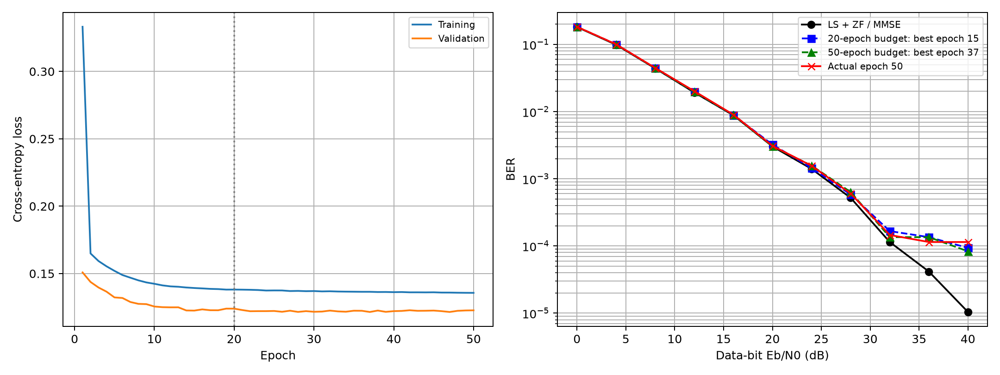

# 20 轮与 50 轮训练对照实验

日期：2026-11-09。

增加训练轮数有改善，50 轮后仍存在无噪声误判。按原程序保存规则比较，40 dB 下的错误从 134 个降到 117 个，无噪声时从 107 个降到 106 个。

训练范围保持 0–40 dB，训练数据、验证数据、初始化、打乱顺序、网络结构及优化器设置均与原 20 轮实验一致。前 20 轮的四项训练和验证指标与原记录完全一致，最大绝对差为 0。

原程序按照混合信噪比验证集的平均交叉熵保存最佳模型：原 20 轮实验选择第 15 轮，本次 50 轮实验选择第 37 轮。为直接观察额外训练的影响，同时保存并测试了第 20 轮和第 50 轮本身的模型。

每种诊断条件包含独立测试的 10,000 个 OFDM 符号、480,000 个数据符号，即 960,000 个比特。同一条件下，各方法使用完全相同的数据。随机种子为 20261109。

| 测试条件 | LS＋ZF 错误比特数 | 原最佳模型（第 15 轮） | 第 20 轮本身 | 本次最佳模型（第 37 轮） | 第 50 轮本身 |
|---|---:|---:|---:|---:|---:|
| 40 dB | 23 | 134 | 175 | 117 | 112 |
| 完全无噪声 | 0 | 107 | 168 | 106 | 92 |

第 50 轮本身相对第 20 轮本身，40 dB 错误减少 36%，无噪声错误减少约 45%。与原程序实际保存的第 15 轮最佳模型相比，第 50 轮的改善较小。本次最佳模型与第 50 轮模型的无噪声错误全部集中在真实信道幅度小于 0.03 的位置。

结果说明：增加训练轮数有帮助；混合信噪比的平均验证损失，不能直接代表高信噪比或无噪声性能。这次单一训练种子的实验尚未消除极深衰落误码，也不用于断言无限增加轮数的结果。

原始程序、原有权重和原有实验结果已通过 SHA-256 核对，均未改动。源码默认仍为 20 轮、0–20 dB；本次在独立脚本中读取原 0–40 dB 实验配置并将轮数设为 50。

- [完整训练记录](history.csv)
- [0–40 dB 对照结果，每点 96,000 比特](comparison_ber.csv)
- [大样本诊断结果，每种条件 960,000 比特](diagnostics_960000bits.csv)
- [按真实信道幅度统计错误](diagnostics_by_channel_magnitude.csv)
- [实验配置与核对结果](summary.json)
- [复现实验脚本](experiment.py)

复现时需将脚本复制到 `runs` 下的新实验文件夹，再从项目根目录运行；脚本会拒绝覆盖已有训练记录。

